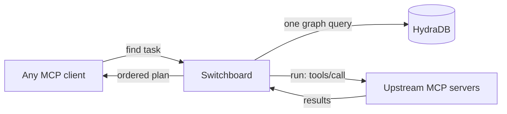

# Switchboard

One MCP gateway for every tool. Your agent describes a task and gets back an
ordered plan, not a sixty-tool catalog.

## The problem

Every tool your agent might use is described in its context on every turn.
That causes four failures:

1. **Bloat.** 60 tools at ~90 tokens each is ~5,500 tokens per turn, to use 4.
2. **Wrong order.** Tool B needs an ID that tool A produces. The model finds
   out by trying, failing, and retrying.
3. **No memory.** The working sequence dies with the session.
4. **No boundary.** The model sees the whole catalog, including dangerous tools.

## What it does

Point Switchboard at your MCP servers once. It discovers every tool, records
what each tool consumes and produces, and stores the dependency graph in
HydraDB.

At request time your agent calls `find` with a task and gets an ordered plan:
goal tool matched by relevance, route completed through the graph, order
checked so every step consumes a type an earlier step produced. It then calls
`run`, and the gateway executes the chain. Successful routes gain weight;
failed steps lose it, so plans improve with use.

The full catalog never enters the model's context.

## What the client sees

| | Direct | Switchboard |
|---|---|---|
| MCP servers configured | 4 | **1** |
| Tool schemas in context | 60 | **2** |
| Schema tokens per turn | 5,453 | **169** |
| Plan order from | model guess | **graph path** |

Two tools, `find` and `run`. No catalog, no fallback list.

## Architecture



## Results

24 tasks, 18 train / 6 holdout, 3 replicates, 5 rounds:

| Mode | Holdout success | Order validity |
|---|---|---|
| BM25 relevance, top-4 | 0.00 | 0.00 |
| BM25 goal + dependency order | 0.08 | 0.96 |
| Uniform graph | 0.33 | 1.00 |
| Learned graph, round 1 | 1.00 | 1.00 |
| Learned graph, round 5 | 1.00 | 1.00 |

## Quick start

```bash
cp .env.example .env
docker compose up -d
./install.sh             # venv + editable install + switchboard on PATH
switchboard status       # HydraDB ready=True
switchboard add mcp filesystem -- npx -y @modelcontextprotocol/server-filesystem "$PWD"
switchboard index
switchboard serve --http 127.0.0.1:8765
```

Add the gateway to your agent (OpenCode shown):

```json
{ "mcp": { "servers": { "switchboard": {
  "type": "local", "command": ["switchboard", "serve"] } } } }
```

Then from your agent: `find(task)` returns a plan, `run(plan_id)` executes it.

## Dashboard

```bash
switchboard dashboard
```

Live graph counts, the dependency map, learning curves, latency, and token
savings at `http://127.0.0.1:8000/`.

## Links

- Repo: https://github.com/sakkshm/switchboard
- Results and methodology: `docs/RESULTS.md`
